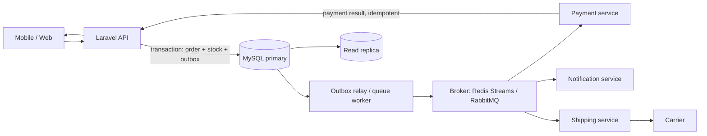

# Jawaban tes Software Engineer

Jawaban berikut mencakup pengalaman kerja, implementasi proyek latihan, dan rancangan sistem.

## 1. Pengalaman pribadi

### 1.1 Infrastruktur — CV Wahana Eloh Nusantara

Di CV Wahana Eloh Nusantara, tantangan infrastruktur yang saya hadapi terjadi pada server internal yang digunakan tim untuk operasional kerja. Lingkungan multi-container itu menggunakan Docker, Traefik sebagai reverse proxy, Sablier untuk pengelolaan lifecycle container, dan menjalankan aplikasi Plane. Insiden berikut terjadi pada layanan internal tersebut, bukan insiden production Medusa dan bukan klaim bahwa service Medusa di production mengalami masalah yang sama.

Kasus yang paling menantang adalah container API Plane terus mengalami crash-loop setelah deployment. Saya memeriksa status dan log container, lalu menemukan bahwa `SECRET_KEY` tidak terbaca. Variabel tersebut sudah saya set di `.env` root, tetapi service API membaca file `.env` miliknya sendiri di `apps/api/.env`. Saya memindahkan variabel ke file konfigurasi service yang tepat, me-restart service, lalu menguji ulang sampai container stabil.

Untuk routing, saya mengatur Traefik melalui Docker labels di `docker-compose.override.yaml` dengan rule `Host(...) || Host(<IP server>)`, agar aplikasi dapat diakses melalui hostname maupun IP server.

Sablier membantu menghemat RAM karena container yang jarang digunakan dimatikan otomatis dan baru dijalankan saat ada request. Trade-off yang saya temui adalah cold-start pada request pertama, container yang sedang scale-to-zero bisa tampak seperti error saat debugging, dan service dengan startup lambat berisiko mengalami timeout. Karena itu saya tidak menggunakan scale-to-zero untuk database atau worker yang harus selalu berjalan.

Pelajaran utama saya: pada sistem multi-container, penyebab masalah tidak selalu berada di kode aplikasi; konfigurasi environment, routing, dan ketergantungan antarservice juga harus diperiksa. Saya mulai dari log, mengubah satu hal per percobaan, lalu memverifikasi hasilnya.

### 1.2 Concurrency — PT Radar Teknologi Komputer

Di sistem absensi PT Radar Teknologi Komputer, saya pernah menemui kasus status kehadiran yang ditampilkan tidak sesuai dengan kondisi sebenarnya. Saya menelusuri request dari frontend, pemrosesan di Laravel, dan data di MySQL. Namun, penyebab pastinya tidak berhasil dipastikan sebagai race condition. Saat itu saya memeriksa alur dan data, tetapi belum menerapkan locking atau unique constraint khusus dan belum menguji dua request secara paralel.

Untuk mencegah masalah serupa, saya akan memvalidasi aturan bisnis di server, membungkus perubahan terkait dalam `DB::transaction()`, menambahkan unique constraint untuk invariant seperti satu absensi per karyawan per periode, dan memakai `lockForUpdate()` jika proses perlu membaca lalu mengubah row yang sama. Verifikasinya adalah mengirim dua request bersamaan dan memastikan hanya satu record valid yang tersimpan.

Sistem tersebut belum memiliki fitur real-time. Secara desain, saya akan memilih polling jika jeda beberapa detik bisa diterima, SSE untuk update satu arah ke dashboard, dan WebSocket hanya jika butuh komunikasi dua arah berfrekuensi tinggi.

### 1.3 Keamanan aplikasi

Contoh yang relevan untuk Laravel adalah **broken access control / IDOR** pada resource order. Jangan percaya bahwa ID yang sulit ditebak adalah otorisasi. Selalu batasi query ke pemilik resource atau periksa policy:

```php
$order = ApiOrder::query()
    ->where('user_id', $request->user()->getKey())
    ->findOrFail($orderId);
```

Admin diperiksa melalui role/policy terpisah. Validasi request dan prepared statements dari Eloquent membantu mencegah input tidak sah dan SQL injection; keduanya tidak menggantikan pemeriksaan otorisasi.

Untuk chatbot, risiko prompt injection yang perlu diwaspadai adalah teks pengguna/dokumen yang mencoba mengubah instruksi model atau meminta data rahasia. Perlakukan konten tersebut sebagai data tidak tepercaya, jangan menaruh secret di prompt, batasi tool dengan allowlist dan otorisasi server, validasi output sebelum tindakan, serta jangan memberikan akses model langsung ke query atau operasi sensitif.

## 2. Coding challenge — implementasi di Abangkuh

API challenge berada di Laravel, berdampingan dengan toko Aimeos yang sudah ada. Frontend latihan Next.js 15.5.29 berada di `storefront/`. Katalog API challenge memakai tabel `products`; pesanan API challenge memakai tabel `orders`/`order_items`, terpisah dari tabel internal Aimeos. Saya menggunakan MySQL pada konfigurasi lokal/Compose; pilihan ini memenuhi opsi stack yang memperbolehkan teknologi lain.

### 2.1 Data model

- `products`: `id`, `name`, `description` (nullable), `price`, `stock_quantity`, `category`, `is_active`, timestamps.
- `orders`: `id`, `order_number` (ULID unik), `user_id`, `status`, `currency`, `total`, timestamps.
- `order_items`: `id`, `order_id`, `product_id`, `product_name` (snapshot), `quantity`, `unit_price` (snapshot), `subtotal`, timestamps; unik per pasangan `order_id` dan `product_id`.
- `inventory_logs`: `id`, `product_id`, `order_id` (nullable), `user_id` (nullable), `action`, `quantity`, `quantity_change`, `stock_after`, `note` (nullable), timestamps.
- `users`: role API tambahan `api_role` (`user` atau `admin`).

Foreign key menjaga relasi antartabel; indeks dipakai untuk kolom pencarian/status yang sering digunakan. Harga dan subtotal disimpan sebagai decimal, bukan floating point.

### 2.2 REST API

| Method | Path | Akses dan fungsi |
|---|---|---|
| `GET` | `/api/products?search=&category=&per_page=` | Publik; pencarian, filter kategori, pagination |
| `GET` | `/api/products/{id}` | Publik; detail produk aktif |
| `POST` | `/api/orders` | JWT user; membuat order dan reservasi stok dari item cart |
| `GET` | `/api/orders` | JWT; daftar order milik user (admin dapat melihat semua) |
| `GET` | `/api/orders/{id}` | JWT; pemilik atau admin |
| `POST` | `/api/inventory/restock` | JWT admin; tambah stok dan audit |
| `GET` | `/api/reports/low-stock` | JWT admin |
| `GET` | `/api/reports/daily-sales?date=YYYY-MM-DD` | JWT admin |

API juga menyediakan endpoint pembayaran simulasi, pembatalan, perubahan status admin, serta register/login/logout. Semua input divalidasi di server; endpoint yang perlu autentikasi memakai JWT, dan endpoint administrasi dilindungi role middleware.

### 2.3 Stock management dan audit trail

1. Checkout mengunci baris produk yang diminta dengan urutan ID menaik di dalam transaksi.
2. Server membaca harga dan stok dari database—bukan dari cart/client—lalu memastikan produk aktif dan stok cukup.
3. Order dan snapshot harga dibuat; stok tersedia dikurangi sebagai reservasi; setiap perubahan dicatat dalam `inventory_logs`. Semua commit atau rollback bersama.
4. `pending → payment_pending → paid`; konfirmasi pembayaran mencatat audit `confirm` tanpa mengurangi stok untuk kedua kalinya.
5. Pembatalan sebelum `shipped` mengembalikan stok dan mencatat `release` dalam transaksi yang sama. Pembatalan order `paid` harus dipasangkan dengan refund melalui provider pembayaran sebelum produksi.

Reservasi penting agar dua checkout tidak sama-sama menjual unit terakhir. Stok yang dipesan langsung dikeluarkan dari stok yang tersedia, meskipun pembayaran belum selesai. Untuk produksi, tambahkan batas waktu reservasi dan worker yang melepas reservasi kedaluwarsa.

### 2.4 State machine order

```text
pending → payment_pending → paid → packed → shipped → delivered
```

Transisi yang diizinkan divalidasi di `InventoryService`: `pending` dapat menuju `payment_pending` atau `cancelled`; `payment_pending` menuju `paid` atau `cancelled`; `paid` menuju `packed`, `cancelled`, atau `refunded`; `packed` menuju `shipped`; `shipped` menuju `delivered`. `cancelled` dapat menuju `refunded`. Pembatalan tidak diizinkan setelah order `shipped`. Pembayaran pada proyek latihan masih simulasi; integrasi provider dan refund nyata belum tersedia.

### 2.5 Keamanan API

API menggunakan JWT dengan role `user`/`admin`, pembatasan order berdasarkan pemilik, validasi request Laravel, dan rate limit login lima request per menit per pasangan email+IP. Endpoint restock, laporan, dan perubahan status hanya untuk admin. Stok dibaca dan diubah dalam transaksi dengan row lock untuk mengurangi risiko overselling.

### 2.6 Frontend Next.js 15.5.29

Frontend latihan memakai Next.js 15.5.29, TypeScript, Tailwind CSS, dan React Context untuk auth/cart. Halaman yang tersedia: product list (`/`), product detail (`/products/{id}`), cart (`/cart`), order history (`/orders`), dan order detail (`/orders/{id}`). Layout responsif, dengan loading state dan error boundary. Token disimpan di memori; refresh halaman mengharuskan login kembali.

### 2.7 Deployment

Docker Compose menjalankan Laravel API, MySQL, Redis, dan storefront Next.js (juga MinIO untuk storage lokal). Konfigurasi menggunakan environment variables dengan template `.env.example`; Redis tidak dipublikasikan ke host dan menggunakan password. Konfigurasi lolos `docker compose config` dengan placeholder validasi untuk variabel wajib; stack lengkap belum dijalankan end-to-end pada lingkungan ini.

### 2.8 Inventory reservation pattern

Saat checkout, sejumlah stok dikurangi dari stok yang tersedia dan dicatat sebagai reservasi sebelum pembayaran selesai. Pembayaran mengonfirmasi reservasi tanpa mengurangi stok lagi; pembatalan yang diizinkan melepaskan reservasi dan mengembalikan stok. Pola ini mencegah dua pembeli mengambil unit terakhir yang sama; produksi sebaiknya memberi reservasi batas waktu agar stok tidak tertahan selamanya.

### 2.9 Optimistic vs pessimistic locking

- **Optimistic:** proses berjalan tanpa mengunci; saat menyimpan, versi/kolom diperiksa. Bagus ketika konflik jarang, tetapi perlu retry dan penanganan konflik.
- **Pessimistic:** transaksi mengunci baris saat memeriksa/mengubah stok. Implementasi ini memilih pessimistic row locking karena oversell stok langka lebih mahal daripada waktu tunggu checkout. Transaksi di-retry terbatas; semua produk dikunci dengan urutan ID yang konsisten.

### 2.10 SSE dibanding WebSocket

SSE memakai HTTP dan cocok untuk update satu arah server → browser seperti perubahan status order; browser otomatis mencoba tersambung ulang dan implementasinya lebih sederhana. Kekurangannya: arah komunikasi hanya dari server, dukungan/proxy perlu diuji, dan koneksi tetap terbuka. WebSocket mendukung dua arah dan cocok untuk interaksi berfrekuensi tinggi, dengan biaya operasi koneksi dan skalabilitas lebih besar. API latihan ini belum memerlukan kanal real-time; status order dimuat melalui HTTP.

### 2.11 Prepared statements

Prepared statements mengirim struktur SQL dan nilai parameter secara terpisah. Database memperlakukan nilai sebagai data, bukan sintaks SQL, dan dapat memakai ulang rencana query. Eloquent/query builder memakai parameter binding:

```php
Product::query()->where('category', $validatedCategory)->get();
```

Jangan merangkai input ke SQL mentah. Jika SQL mentah memang diperlukan, gunakan placeholder dan binding untuk setiap nilai.

## 3. System design — skala e-commerce

### 3.1 Pemrosesan order berbasis event



Simpan order, reservasi stok, dan event outbox dalam satu transaksi agar event tidak hilang jika broker sedang bermasalah. Consumer mengakui event setelah proses berhasil, memakai `event_id` untuk deduplikasi, retry dengan backoff, dan dead-letter queue untuk kegagalan permanen. Payment callback diverifikasi tanda tangannya dan idempotent. Sketsa ini adalah rancangan skalabilitas; worker/broker eksternal belum dijalankan oleh aplikasi latihan.

### 3.2 Konsistensi saat 100+ checkout berebut stok 1

Secara desain, checkout mengunci baris produk dalam transaksi, memeriksa `stock_quantity` di database, lalu mengurangi stok hanya jika jumlahnya cukup. Checkout untuk produk yang sama diserialisasi oleh database; satu transaksi dapat mengambil unit terakhir, sedangkan transaksi berikutnya mendapat kegagalan stok dan tidak meninggalkan order parsial. Constraint dan update bersyarat `UPDATE ... WHERE stock_quantity >= ?` dapat menjadi perlindungan tambahan. Cache bukan sumber kebenaran stok.

Sebagai verifikasi terisolasi, saya menjalankan 20 proses PHP serentak yang memanggil `InventoryService::createOrder` pada MySQL lokal dengan stok awal satu unit. Barrier melepas semua worker setelah masing-masing membuka koneksi MySQL, sehingga transaksi dimulai hampir bersamaan dan penguncian baris diuji terhadap akses yang bersaing, bukan eksekusi satu per satu. Hasilnya: satu order berhasil dibuat, 19 ditolak karena stok habis, stok akhir 0, dan tercatat satu log reservasi. Ini menguji jalur service/database, bukan request HTTP atau load test 100+ checkout; checkout end-to-end melalui storefront belum dilakukan.

### 3.3 Mencegah deadlock

Kunci baris produk dalam urutan ID yang konsisten; jaga transaksi sesingkat mungkin; hindari request jaringan saat transaksi/lock masih terbuka; gunakan indeks yang tepat; dan retry terbatas untuk deadlock yang terdeteksi. Log deadlock dan ukur frekuensinya—jangan retry tanpa batas.

### 3.4 Target 99.99% uptime

Sebagai rancangan untuk target 99.99% uptime, deploy aplikasi stateless pada beberapa instance lintas availability zone di belakang load balancer/health check. Gunakan MySQL primary dengan replikasi sinkron atau managed HA untuk failover, backup terenkripsi dan uji pemulihan berkala; tetapkan RPO/RTO dan pahami risiko failover. Redis dibuat HA tetapi hanya untuk cache/limiter, bukan sumber data order. Queue memakai worker redundan dan retry idempotent. Pantau error rate, latensi, lag replica, dan kapasitas; lakukan deploy bertahap serta latihan failover. Ini adalah rancangan, bukan klaim bahwa infrastruktur tersebut telah dibangun.

### 3.5 Caching

Katalog publik yang jarang berubah dapat memakai Redis dengan TTL pendek-menengah, key versi/kategori, dan invalidasi saat produk berubah; hindari menyajikan stok lama sebagai jaminan checkout. Detail order bersifat privat dan berubah lebih sering: jangan gunakan cache bersama. Jika perlu, cache per-user dengan TTL pendek dan invalidasi setelah setiap transisi status. Respons checkout selalu membaca database utama.

## 4. Cybersecurity challenge

### 4.1 Lima risiko besar dan kontrol

1. **A01 Broken Access Control / IDOR.** Scope query ke pemilik atau admin:

   ```php
   $order = ApiOrder::query()
       ->where('user_id', $request->user()->getKey())
       ->findOrFail($orderId);
   ```

2. **A07 Identification and Authentication Failures.** Hash password, bandingkan secara aman, batasi percobaan login, dan gunakan JWT ber-expiry:

   ```php
   if (! $user || ! Hash::check($data['password'], $user->password)) {
       throw ValidationException::withMessages([
           'email' => ['The provided credentials are incorrect.'],
       ]);
   }
   ```

3. **A03 Injection.** Validasi input dan gunakan parameter binding, bukan merangkai input ke SQL:

   ```php
   $validated = $request->validate([
       'category' => ['required', 'string', 'max:100'],
   ]);

   $products = ApiProduct::query()
       ->where('category', $validated['category'])
       ->paginate(20);
   ```

4. **A02 Cryptographic Failures.** Gunakan password hashing adaptif dan secret kuat dari environment/secret manager; wajibkan HTTPS serta jangan log token/password:

   ```php
   $passwordHash = Hash::make($data['password']);
   ```

5. **A05 Security Misconfiguration.** Batasi origin CORS dan lindungi Redis di jaringan internal:

   ```php
   'allowed_origins' => explode(',', env('CORS_ALLOWED_ORIGINS', 'https://store.example.com')),
   'supports_credentials' => false,
   ```

   ```yaml
   command: ['sh', '-c', 'exec redis-server --appendonly yes --requirepass "$$REDIS_PASSWORD"']
   ```

   Contoh ini menunjukkan kontrol inti; validasi input, least privilege, patch dependency, dan pembatasan port tetap diperlukan. Pada API latihan, logout juga mencabut JWT melalui denylist ber-TTL di cache sampai token kedaluwarsa.

### 4.2 IDOR pada endpoint order

Contoh uji pada aplikasi lokal milik saya atau sistem yang saya berwenang menguji: User A login, lalu meminta order milik User B menggunakan token User A:

```http
GET /api/orders/1042 HTTP/1.1
Host: localhost:8000
Accept: application/json
Authorization: Bearer <USER_A_TOKEN>
```

Jika order `1042` milik User B dan server mengembalikan `200` beserta datanya, endpoint rentan IDOR. Perbaiki dengan membatasi query berdasarkan pemilik atau memberi akses admin secara eksplisit:

```php
$query = ApiOrder::query();
if ($request->user()->api_role !== 'admin') {
    $query->where('user_id', $request->user()->getKey());
}
$order = $query->findOrFail($orderId);
```

API latihan menerapkan scoped query melalui helper `visibleOrder` di `OrderController` dan mengembalikan `404` untuk order milik pengguna lain. Pemeriksaan dilakukan pada endpoint detail maupun aksi pengguna (pembayaran/pembatalan); middleware role membatasi operasi admin. Regression test dengan dua akun memastikan akses lintas pemilik menghasilkan `404`. Sembilan tes API lulus (39 assertions). Stack storefront end-to-end belum dijalankan. Pola scoped query atau Laravel Policy perlu diterapkan pada setiap resource privat.

Jika ownership dipisahkan menjadi middleware, pola lengkapnya dapat seperti berikut. Ini contoh desain; implementasi proyek saat ini memakai helper scoped query di controller.

```php
namespace App\Http\Middleware;

use App\Models\ApiOrder;
use Closure;
use Illuminate\Http\Request;
use Symfony\Component\HttpFoundation\Response;

final class EnsureOrderOwnerOrAdmin
{
    public function handle(Request $request, Closure $next): Response
    {
        $user = $request->user();
        $orderId = $request->route('order');

        abort_unless($user, 401);
        abort_unless($orderId, 404);

        $query = ApiOrder::query()->whereKey($orderId);
        if ($user->api_role !== 'admin') {
            $query->where('user_id', $user->getKey());
        }

        $request->attributes->set('authorizedOrder', $query->firstOrFail());

        return $next($request);
    }
}
```

Tambahkan alias berikut ke `protected $middlewareAliases` yang sudah ada, lalu pasang sesudah autentikasi JWT hanya pada route yang memiliki parameter `{order}` seperti detail, pembayaran, dan pembatalan:

```php
'order.owner' => EnsureOrderOwnerOrAdmin::class,
```

```php
// routes/api.php
Route::middleware(['jwt.auth', 'order.owner'])->group(function () {
    Route::get('/orders/{order}', [OrderController::class, 'show']);
    Route::post('/orders/{order}/payment', [OrderController::class, 'startPayment']);
    Route::post('/orders/{order}/cancel', [OrderController::class, 'cancel']);
});
```

Controller dapat mengambil model dari atribut `authorizedOrder`. Respons `404` untuk order yang tidak dimiliki menghindari pengungkapan apakah ID tersebut ada, sedangkan `403` dapat mengungkapkan bahwa resource ada tetapi tidak boleh diakses.

### 4.3 Redis Docker

Risiko default: layanan tanpa autentikasi dapat dibaca/diubah dari jaringan yang bisa menjangkaunya; data/cache dapat dicuri atau dirusak; perintah tak terbatas dapat menyebabkan penyalahgunaan resource atau akses file jika konfigurasi host berbahaya. Compose latihan mewajibkan password, tidak mem-publish port Redis, dan menempatkannya di network internal. Produksi sebaiknya gunakan ACL user least-privilege, TLS lintas host, secret manager, network policy, versi terpelihara, dan monitoring; jangan menganggap password saja cukup.

### 4.4 Rate limit dan account lockout

Implementasi login saat ini membatasi lima request per menit untuk setiap pasangan email yang dinormalisasi dan IP. Ini fixed window sederhana; batas window dapat memungkinkan burst saat pergantian menit. Sebagai penguatan, saya akan menambahkan backoff akun bertahap (misalnya 1, 2, 4, 8 menit hingga maksimum 30 menit), limit per IP/global untuk menahan rotasi akun, dan notifikasi atau pemulihan bila perlu. Saya tidak akan mengunci akun permanen karena dapat disalahgunakan untuk denial-of-service.

Sliding window atau token bucket memberi pembatasan yang lebih merata; state harus konsisten lintas instance dan dapat disimpan di Redis. Backoff akun bertahap berikut merupakan rancangan tambahan, bukan fitur yang saat ini diterapkan.

Pseudocode:

```text
function login(identity, ip, password):
    keyAccount = normalize(identity)
    if Redis.isLocked(keyAccount) or Redis.isLocked(ip):
        return GENERIC_ERROR

    # Sliding window per account and IP
    accountAttempts = Redis.slidingWindowAdd("login:acct:" + keyAccount, now, 60 seconds)
    ipAttempts = Redis.slidingWindowAdd("login:ip:" + ip, now, 60 seconds)

    if accountAttempts > 5 or ipAttempts > 100:
        failures = Redis.incr("lockfail:" + keyAccount)
        delay = min(30 minutes, 1 minute * 2^(failures - 1))
        Redis.setEx("lock:" + keyAccount, delay)
        return GENERIC_ERROR

    if verifyPassword(identity, password):
        Redis.delete("lockfail:" + keyAccount)
        createSessionOrJwt()
    else:
        Redis.incr("failure:" + keyAccount)
        return GENERIC_ERROR
```

`slidingWindowAdd` memakai sorted set dengan timestamp sebagai score dan menghapus entry yang kedaluwarsa. Normalisasi identitas (email lowercase/trim), tetapi jangan membocorkan status akun pada HTTP response.

### 4.5 CORS

CORS adalah mekanisme browser yang mengatur apakah halaman pada satu origin boleh membaca respons atau mengirim request tertentu ke origin lain. Contohnya, frontend `https://frontend.example.com` dan API `https://api.example.com`.

Untuk request tertentu, browser mengirim preflight `OPTIONS` sebelum request utama. Server membalas origin, method, dan header yang diperbolehkan. Browser menolak respons jika policy tidak sesuai.

Kesalahan konfigurasi dapat membolehkan origin atau situs tidak dipercaya membaca data pengguna, terutama jika request memakai cookie atau kredensial lintas origin. CORS bukan autentikasi dan tidak melindungi API dari klien non-browser.

Pada API latihan, `config/cors.php` memakai allowlist dari `CORS_ALLOWED_ORIGINS`, membatasi method/header, dan menetapkan `supports_credentials=false`. Autentikasi menggunakan Bearer JWT, bukan cookie lintas origin:

```php
'allowed_methods' => ['GET', 'POST', 'PATCH', 'OPTIONS'],
'allowed_origins' => array_values(array_filter(array_map(
    'trim',
    explode(',', (string) env('CORS_ALLOWED_ORIGINS', 'http://localhost:3000,http://127.0.0.1:3000'))
))),
'allowed_headers' => ['Accept', 'Authorization', 'Content-Type', 'X-Requested-With'],
'supports_credentials' => false,
```

CORS tetap bukan pengganti autentikasi: backend memvalidasi Bearer JWT dan otorisasi pemilik order pada setiap request.

## 5. Refleksi dan perencanaan

### 5.1 Tiga hal teknis terbaru yang saya pelajari

1. **Arsitektur modular dan Domain-Driven Design (DDD) untuk backend multi-client.** Saya mempelajari cara memisahkan modul domain agar backend TypeScript dapat melayani beberapa jenis aplikasi dan role tanpa mencampur aturan bisnis dengan lapisan API atau UI. Pemisahan ini membantu maintainability dan memudahkan penambahan fitur.
2. **Konsistensi data dan concurrency control.** Saya mempelajari cara mencegah inkonsistensi ketika beberapa proses mengakses data bersamaan, misalnya stok produk, dengan transaksi database, pessimistic row locking, penguncian dalam urutan konsisten untuk mengurangi deadlock, unique constraint sebagai perlindungan terakhir, dan audit trail perubahan.
3. **Pengelolaan aplikasi multi-container dengan Docker, Traefik, dan Sablier.** Saya mempelajari cara men-debug masalah konfigurasi environment, routing, CORS, dan komunikasi antarcontainer, serta trade-off scale-to-zero seperti cold-start dan service yang tidak cocok menggunakannya.

### 5.2 Troubleshooting data absensi salah

1. Catat waktu, pengguna terdampak, endpoint, dan contoh record; jangan langsung mengubah data.
2. Periksa apakah gejala berasal dari UI/cache/timezone atau nilai database; cocokkan query, filter tanggal, zona waktu, dan relasi.
3. Telusuri audit log, job, deploy, dan perubahan terbaru; cari pola duplikat/race atau mass update.
4. Reproduksi pada salinan data terkontrol; cek constraint dan transaksi pada jalur tulis.
5. Mitigasi dengan menghentikan job/endpoint yang salah jika masih menulis; siapkan koreksi terukur dengan backup dan persetujuan.
6. Verifikasi sampel sebelum/sesudah, tambahkan regression test/monitoring, lalu dokumentasikan akar masalah.

### 5.3 Pilihan prioritas bila hanya punya dua hari

Dengan asumsi tidak ada insiden produksi atau target response time yang sedang dilanggar, saya memilih **(c) memperbaiki tech debt**. Dalam dua hari saya akan memilih satu debt di alur kritis yang paling memperlambat perubahan atau meningkatkan risiko bug, menjalankan regression test, lalu mengirim perubahan kecil yang aman di-rollback. Saya tidak menjanjikan response time 2x lebih cepat tanpa baseline dan profiling. Jika ada insiden keamanan atau performa yang melanggar SLO, prioritas berubah ke mitigasi masalah tersebut.
